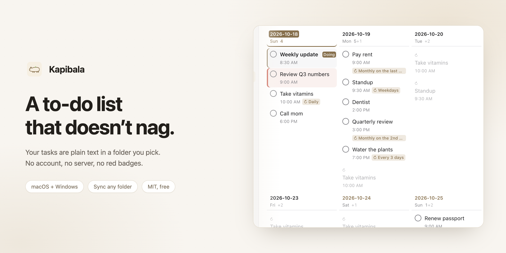
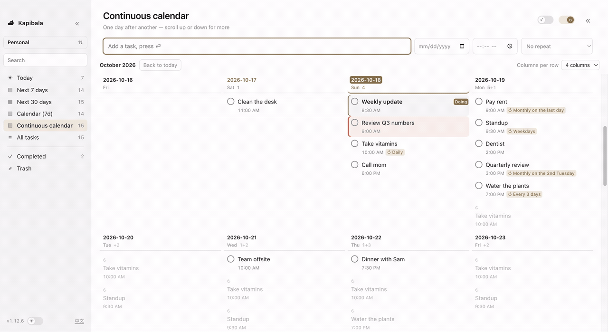
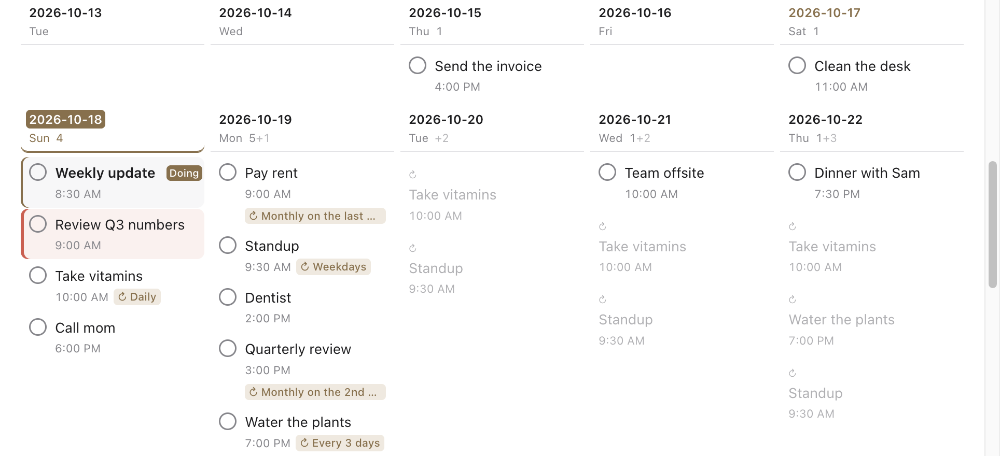
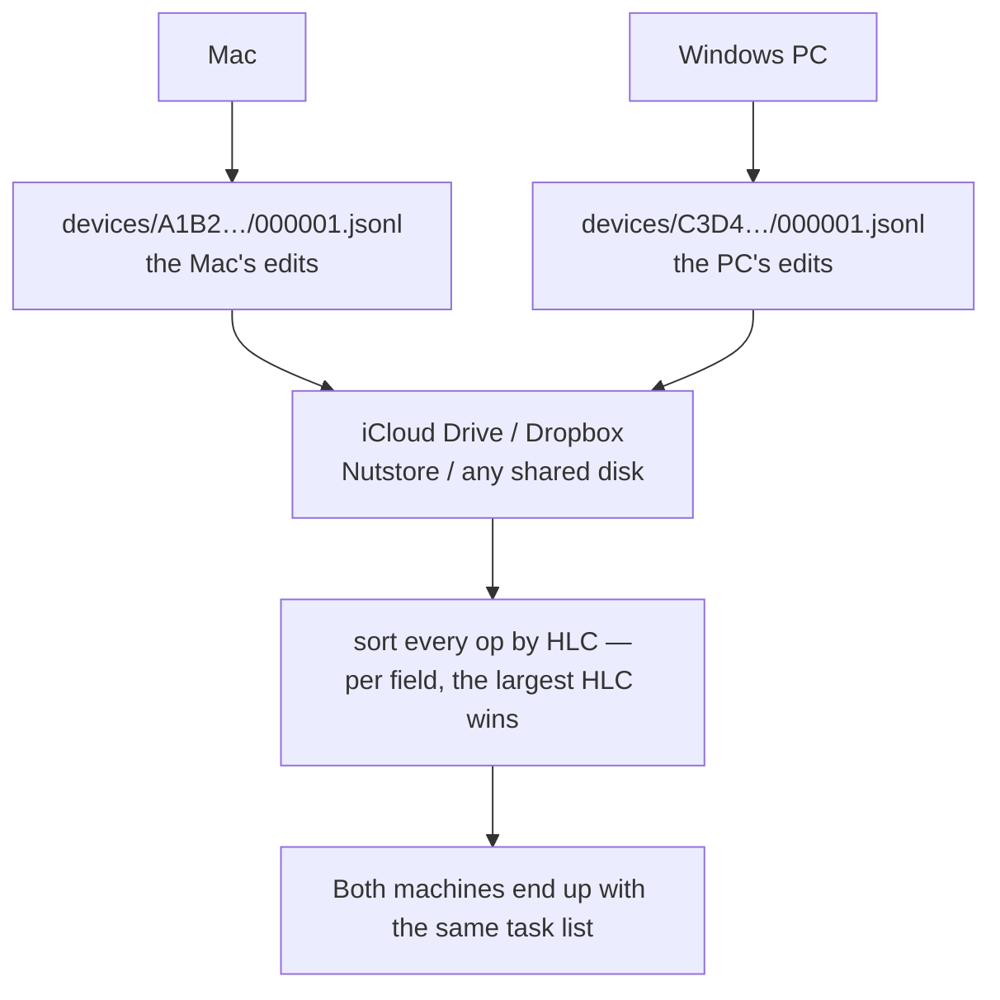

<p align="center">
  <a href="https://github.com/yaodongen/kapibala/releases/latest">
    
  </a>
</p>

<p align="center">
  <b>A local-first to-do app for macOS and Windows that doesn't nag.</b><br>
  Every task is a plain-text file in a folder you pick — sync it with any drive you already use, or with nothing at all.
</p>

<p align="center">
  <a href="https://github.com/yaodongen/kapibala/releases/latest"></a>
  <a href="./LICENSE"></a>
  
  
  
</p>

<p align="center">
  <a href="#download"><b>Download</b></a> ·
  <a href="#how-it-compares">How it compares</a> ·
  <a href="#the-continuous-calendar">Continuous calendar</a> ·
  <a href="#features">Features</a> ·
  <a href="#how-sync-works">Sync</a> ·
  <a href="#faq">FAQ</a> ·
  <a href="./README.zh.md">简体中文</a>
</p>

---

**It never goes online.** There is no account and no server. Your tasks live in JSON Lines files in
a folder you pick — read them, back them up, delete them, whenever you like.

**Sync is a folder.** Put the vault in iCloud Drive, OneDrive, Dropbox or Nutstore and a Mac and a
Windows PC can share it. Keep it off a synced drive and Kapibala is a purely local app.

**It does not nag.** No notifications, no red badges, no streaks, no "12 overdue" counter. Whatever
you did not finish stays on the day it belonged to — scroll up and there it is.

## How it compares

|  | A typical cloud to-do app | Kapibala |
| :--- | :--- | :--- |
| Where your tasks live | Someone else's server | A folder on your disk |
| Sign-in | Required | None |
| Offline | Partially | Always |
| Sync | Their cloud, their plan | Any folder sync you already pay for |
| Reminders, badges, streaks | Built to pull you back | None — it waits for you |
| Data format | Opaque, export if you're lucky | JSON Lines you can read in any editor |
| Price | Subscription | Free, MIT |
| Phone app | Usually the main product | Not yet — desktop only |

The closest thing in spirit is Obsidian: the app is a view over files you own, not a service you
log into.

## Download

<p align="center">
  <a href="https://github.com/yaodongen/kapibala/releases/latest">
    
  </a>
</p>

| Your machine | File | Notes |
| :--- | :--- | :--- |
| macOS 12+ (Apple silicon) | `Kapibala-*-arm64.dmg` | Open, drag into Applications |
| macOS 12+ (Intel) | `Kapibala-*-x64.dmg` | Open, drag into Applications |
| Windows 10+ | `Kapibala-*-setup.exe` | Per-user install, no admin rights |

No Node.js, Homebrew or other runtime is needed. The installer is around 100 MB.

<details>
<summary><b>The first launch is blocked once — the builds are not signed yet</b></summary>

- **macOS**: double-click once (it will be refused), then open **System Settings → Privacy &
  Security** and click **Open Anyway** near the bottom. Or run
  `xattr -dr com.apple.quarantine /Applications/Kapibala.app`.
- **Windows**: SmartScreen stops it once — click **More info** → **Run anyway**.

Notarizing requires an Apple Developer Program membership at $99/year; code-signing a Windows
installer costs about the same. This project is free and has not paid either bill, so the extra
click is on you.

</details>

## The Continuous calendar

This is the screen the app opens on. Days are **not cut into months** — they run one after another,
endlessly, in both directions: scroll up for months of history, down for years ahead. How many
cells fit in a row is yours to pick (3–7, five by default).

<p align="center">
  
</p>

- **Today is a line.** Today's cell gets no fill — just an accent-coloured line under the day
  header, curving up slightly at both ends. One glance across the grid and you know where you are.
- **Every cell carries its own full date and weekday.** There are no Monday-to-Sunday columns on
  this screen (columns and weekdays do not line up), so each cell spells it out: `2026-10-05 / Mon`.
  Weekends turn the date accent-coloured, and the toolbar names the month as you scroll.
- **Drag to reschedule.** Drag a task from one day to another and the time of day stays put; which
  day it lands on, and where it sits in that day, is wherever you drop it.
- **Repeats show you where they will land.** A fixed-schedule task such as "read 20 minutes a day"
  is drawn on the days it will fall on as greyed-out rows — display only: they cannot be ticked
  off, dragged or deleted, and they stay out of the sidebar counts. "N days after completion"
  repeats are left alone (their dates depend on when you tick one off). There is a toggle in the
  toolbar, on by default, reaching one year ahead at most.
- **Overdue never piles up.** Nothing unfinished is moved to today, and nothing collects into a
  list that grows longer every week — it stays on the day it belonged to.

### Let the unimportant ones go by

A to-do list turns into an invoice you owe yourself surprisingly fast: yesterday's leftovers sit
in today, today's slide into tomorrow, the number keeps climbing, and eventually you stop opening
the app.

Kapibala does not work that way:

- **Today's cell holds today's load** — it does not carry yesterday's balance. Yesterday's things
  stay in yesterday's cell; nothing is rescheduled for you, and nothing counts what you "owe".
- **No notifications, no red badges, no streaks**, and no "N overdue" figure. If you do not open
  the app, it will not come looking for you.
- **Do it when you want to.** If something really matters, mark it **Important** and it goes to the
  top of its day with a red bar on the left; mark what you are working on **In progress** and the
  row carries a "Doing" badge. Everything else can wait — or not happen.



> That one is scrolled back a few days: what was left undone between Oct 13 and Oct 17 is still on
> its own day — not moved to today, and not collected into an "overdue" list.

## Features

**Capture**

- Notes, with Markdown
- Start date and time
- Say it in the title — `every day read`, `every weekend run`, `next monday at 3pm review` — and the
  date, time and repeat are filled in for you
- Repeats: daily / weekly on a weekday / weekdays only / weekends only / monthly on a date /
  **the second Tuesday of every month** / **the last day of every month** / yearly, and **every N
  days** (type 17, say)
- Search across titles and notes; space-separated words all have to match

**Calendar**

- Continuous calendar (the default), Today, Next 7 days, Next 30 days, Calendar (7d), All tasks,
  Completed, Trash
- Drag to reschedule; the time of day stays
- Mark **Important** (red bar, top of its day) or **In progress** ("Doing" badge); several tasks can
  be in progress at once
- One click to complete, one click to delete — into the trash, not gone for good; the trash empties
  in one click

**App**

- macOS and Windows, from one codebase
- English and Chinese; follows the system language, switchable any time from the bottom-left corner
- Light and dark, following the system
- Several vaults: one for work, one for life, switched at any time and never mixed
- Window size and detail-pane state are remembered per view
- Closing the window tucks it away and the app keeps running. To quit: on macOS right-click the
  Dock icon and choose Quit; on Windows right-click the tray icon
- The bottom-left corner shows the version number; clicking it opens the log

## How sync works

Every machine — Mac or Windows — owns one subfolder inside the vault and writes only there; the
sync service you picked just carries files around.



1. **Write.** Every edit becomes one line appended to a log file in your own device folder
   (`devices/A1B2…/`). A machine never writes into another machine's folder.
2. **Move.** Your sync service uploads the files it finds and downloads the ones it does not have
   yet. Plain files, nothing else.
3. **Merge.** When the vault changes, each machine re-reads every device folder and sorts all ops
   by HLC — a hybrid logical clock (wall time, a counter and the device ID), so the order is total
   and agreed on by everyone. Per field, the largest HLC wins.

Two edits to the same task on two machines are not a conflict: whichever write is later wins for
each individual field, and fields nobody touched are left alone. The rule does not depend on the
order things arrive in, so both land on exactly the same task list — including edits made while
one of them was offline, which simply land when the file syncs.

Because no file is ever written by two machines, the classic synced-folder failure — the
`000001 2.jsonl` conflict copy — cannot happen. The same holds across platforms: a Mac and a PC
can share one vault because neither ever writes into the other's device folder.

## Privacy

- **The app never goes online.** The only thing that touches your tasks is the sync service you
  picked. No telemetry, no crash reporting, no update pings.
- **A readable format.** Storage is JSON Lines — one JSON object per line, plain text, not an
  opaque binary blob. The layout is documented in [`docs/storage.md`](./docs/storage.md).
- **Nothing to migrate away from.** Copy the folder to back it up; delete the app and the data is
  still yours.

## FAQ

**Do I have to use iCloud?**

No. The vault folder can live anywhere — `~/Documents`, an external drive, Dropbox, Nutstore, any
sync service. Keep it off a synced drive and the app is purely local.

**Do unfinished tasks pile up forever?**

In the Continuous calendar they stay on their own day, out of your way. The list views (Today /
Next 7 days / Next 30 days) do collect what is still open into an **Overdue** group at the top, so
you can clear it in one pass when you feel like it — but that is all it does: no reminders, no
counters, nothing chasing you.

**Can a Mac and a Windows PC share one vault?**

Yes. Each machine gets its own device folder inside the vault, so mixing platforms causes no
fights, and tasks and notes look identical on both sides. Your sync service only has to carry
files across unchanged (iCloud Drive, OneDrive, Dropbox and Nutstore all do).

**Is there an iPhone or Android app?**

Not yet. Kapibala is a desktop app for macOS and Windows; the vault is plain files, so other tools
can read it, but there is no mobile client today.

**What happens if I stop using it?**

Nothing. There is no account to cancel and no server holding your data. Delete the app and keep
the folder.

**"Kapibala"?**

Capybara. The least anxious animal on earth. A to-do list should make you a little more like one.

## Development

<details>
<summary><b>Build it yourself</b></summary>

Needs Node 22.18+ (the sources run directly, there is no compile step) and `corepack`. On a fresh
clone:

```bash
make install     # once
make install-app # build and install into /Applications
```

`make help` lists everything else — launching a dev build, tests, dmg / setup.exe, the CLI.

**Windows**: development happens on macOS — no Windows dev machine needed. `make win` cross-builds
`apps/desktop/release/Kapibala-*-setup.exe` from a Mac, and on a release GitHub Actions builds
both platforms for the same tag.

To see what the Windows branch looks like while sitting on a Mac (the tray, the window buttons
Windows draws itself, the layout inset, `Ctrl+Enter`), flip one switch:

```bash
cd apps/desktop
KAPIBALA_OS=win32 corepack pnpm exec electron .
```

The command-line manual is [`docs/cli.md`](./docs/cli.md): after `make deploy` installs `kapi`,
run `kapi --help`, or just `kapi add "buy groceries" --at today` and `kapi today`.

Design notes live in [`docs/`](./docs): [`architecture.md`](./docs/architecture.md) for how the
pieces fit together, [`storage.md`](./docs/storage.md) for the on-disk format.

</details>

## If you like it

Kapibala is free and MIT-licensed. If it fits the way you work, **a star helps other people find
it** — that is the entire marketing budget.

Bug reports and ideas are welcome in [Issues](https://github.com/yaodongen/kapibala/issues).
Screenshots on this page are the real app, taken on macOS.

MIT, see [LICENSE](./LICENSE).
