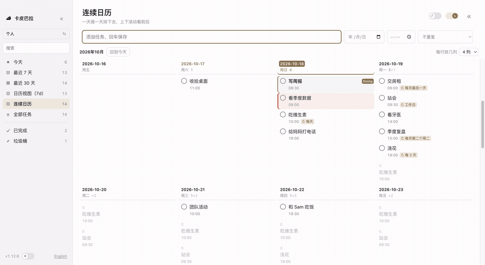
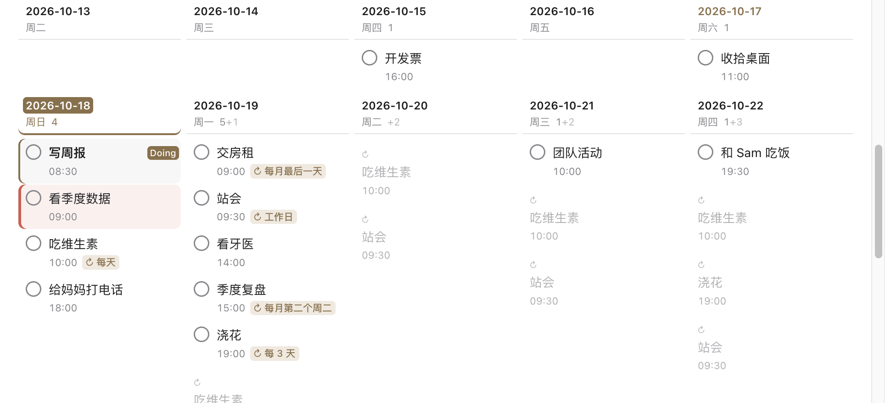
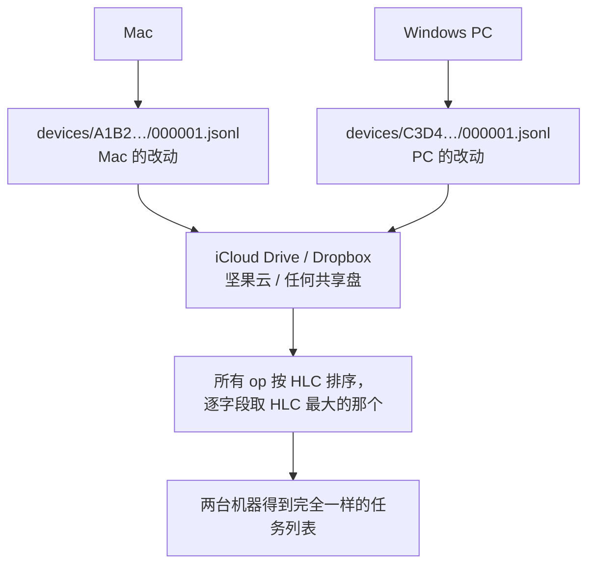

<p align="center">
  <a href="https://github.com/yaodongen/kapibala/releases/latest">
    
  </a>
</p>

<p align="center">
  <b>macOS / Windows 上的本地优先待办清单 —— 不催你的那种。</b><br>
  任务就是你选的文件夹里的纯文本 —— 放进任何同步盘，或者干脆不联网。
</p>

<p align="center">
  <a href="https://github.com/yaodongen/kapibala/releases/latest"></a>
  <a href="./LICENSE"></a>
  
  
  
</p>

<p align="center">
  <a href="#下载"><b>下载</b></a> ·
  <a href="#和别的待办比">和别的待办比</a> ·
  <a href="#连续日历">连续日历</a> ·
  <a href="#功能">功能</a> ·
  <a href="#多台设备怎么同步">同步</a> ·
  <a href="#常见问题">常见问题</a> ·
  <a href="./README.md">English</a>
</p>

---

**它不联网。** 没有账号，没有服务器。任务是你选的文件夹里的 JSON Lines —— 想读就读、想备份就备份、想删就删。

**同步就是一个文件夹。** 放进 iCloud Drive、OneDrive、Dropbox 或坚果云，Mac 和 Windows 能共用一份；不放同步盘，它就是纯本地应用。

**它不催你。** 没有通知、没有红点、没有连续打卡、没有"逾期 12 项"。没做完的事留在原来那一天，往上滚就在那儿。

## 和别的待办比

|  | 常见的云端待办 | 卡皮巴拉 |
| :--- | :--- | :--- |
| 任务存在哪 | 别人的服务器 | 你自己的磁盘 |
| 要登录吗 | 要 | 不用 |
| 离线 | 部分可用 | 一直可用 |
| 同步 | 厂商的云、厂商的套餐 | 你已经在用的任何同步盘 |
| 提醒、红点、连续打卡 | 就是为了把你拉回来 | 没有，它等你 |
| 数据格式 | 黑盒，能不能导出看运气 | JSON Lines，任何编辑器都能打开 |
| 价格 | 订阅 | 免费，MIT |
| 手机 App | 通常才是主产品 | 还没有，只有桌面端 |

思路和 Obsidian 是一样的：应用只是你自己那些文件的一个视图，而不是一个要登录的服务。

## 下载

<p align="center">
  <a href="https://github.com/yaodongen/kapibala/releases/latest">
    
  </a>
</p>

| 你的机器 | 文件 | 说明 |
| :--- | :--- | :--- |
| macOS 12+（Apple 芯片） | `Kapibala-*-arm64.dmg` | 打开，拖进「应用程序」 |
| macOS 12+（Intel） | `Kapibala-*-x64.dmg` | 打开，拖进「应用程序」 |
| Windows 10+ | `Kapibala-*-setup.exe` | 装在当前用户目录，不需要管理员权限 |

不需要 Node.js、Homebrew 或别的运行时。安装包约 90–100 MB。

<details>
<summary><b>首次打开会被系统拦一次 —— 因为还没签名</b></summary>

- **macOS**：双击一次（会被拒），然后到 **系统设置 → 隐私与安全性**，在下方点 **仍要打开**。
  或者终端里一句：`xattr -dr com.apple.quarantine /Applications/Kapibala.app`
- **Windows**：SmartScreen 会拦一下 —— 点 **更多信息** → **仍要运行**。

Apple 公证要开发者会员（99 美元/年），Windows 代码签名的证书也差不多。这个项目免费，两笔都没交，
只能麻烦你多点一下。

</details>

## 连续日历

打开就是这一屏。日子**不分月**，一天接一天往下铺，上下都能无限滚：往前翻得到几个月前，往后一直排到几年以后。
每行放几个格子由你定（3~7，默认 5）。

<p align="center">
  
</p>

- **今天是一道线。** 今天那格不铺底色，只在表头底下压一道强调色的线，两头顺着圆角微微上翘 ——
  一屏数字扫下来，一眼就知道自己站在哪。
- **每格自己带着完整日期和周几。** 这一屏没有"周一到周日"的固定列（列和星期本来就不对齐），
  所以每格都写全：`2026-10-05 / 周一`；周末那两天日期换成强调色。顶栏那行字跟着滚动报当前月份。
- **拖一下就改期。** 把任务从一天拖到另一天，原来的时刻不变；落在哪天、排在第几位，都按你手拖的位置来。
- **周期任务往后排在哪几天，先演给你看。** 「每天读书 20 分钟」这类固定周期的任务，未来会排到哪几天会**置灰**
  画出来 —— 只是展示：勾不了、拖不动，也不进侧栏条数。「完成后 N 天再来」那种日期取决于你什么时候勾，
  算不出来，不推。顶栏有开关（默认开），最远推到今天 + 1 年。
- **逾期不堆成一坨。** 没做完的事不会挪到今天，也不会聚成一个越滚越大的清单 —— 它就在原来那一天。

### 让不重要的事情过去

待办清单最容易长成一份越来越长的欠账单：昨天没做的今天还在，今天没做的明天又在，数字一天比一天大，
最后你不想打开它了。

卡皮巴拉不这么干：

- **今天这一格就是今天的量**，不背昨天的账 —— 昨天的事留在昨天那一格，不顺延，也不算你"欠了多少"。
- **没有通知，没有红点，没有连续打卡**，也没有"逾期 X 项"。你不开它，它不会来找你。
- **想做的时候再做。** 真要紧的事，标一个「重要」就排到那天最前面（左侧一道红竖条）；正在做的标
  「进行中」，行上带一枚 "Doing" 徽标。剩下的，让它过去。



> 上面这张是往上滚回去看的：10 月 13 日到 17 日没做完的事，都还在各自那一天 —— 没有挪到今天，
> 也没有堆成一份"逾期清单"。

## 功能

**记录**

- 备注，支持 Markdown
- 开始日期和时间
- 直接写在标题里 —— `每天看书`、`每周末跑步`、`明天下午3点开会` —— 日期、时间、重复都会自动填好
  （[全部写法](./docs/dates.zh.md#重复)）
- 重复：每天 / 每周某天 / 工作日 / 周末 / 每月某日 / **每月第二个周二** / **每月最后一天** / 每年，
  也可以自己填天数（比如每 17 天）
- 搜索：标题和备注一起搜，空格分隔多个词按全部命中

**日历**

- 连续日历（默认）、今天、最近 7 天、最近 30 天、日历视图（7d）、全部任务、已完成、垃圾桶
- 拖动改期，原来的时刻不变
- 标「重要」（左侧红竖条，排到当天最前）或「进行中」（"Doing" 徽标）；可以同时有好几条在进行中
- 一键完成、一键删除（进垃圾桶，不是真删；垃圾桶可以一键清空）

**应用**

- macOS 和 Windows，同一套代码
- 中英文，默认跟随系统语言，左下角随时切换
- 明暗主题跟随系统
- 也支持多个库：工作一个、生活一个，互不干扰，随时切换
- 窗口大小、详情栏开合按视图记住
- 关掉窗口只是收起来，应用留在后台；要退出：macOS 上右键 Dock 图标选「退出」，Windows 上右键托盘图标
- 左下角显示当前版本号，点它就是查看日志

## 多台设备怎么同步

每台机器（Mac 也好，Windows 也好）在库里占一个自己的子目录，只往里写；你选的同步服务只负责搬运文件。



1. **写。** 每次改动都往自己设备目录（`devices/A1B2…/`）里的日志文件末尾追加一行。一台机器永远不写别人的目录。
2. **搬。** 你的同步服务把本地文件传上去、把还没有的拉下来。都是普通文件，仅此而已。
3. **合。** 库一变，每台机器就重读所有设备目录，把全部 op 按 HLC 排序 —— HLC 是混合逻辑时钟
   （墙上时间 + 计数器 + 设备 ID），排序结果是全序的，每台机器算出来都一样 —— 然后逐字段取 HLC 最大的那个。

同一件事在两台机器上各改一次不算冲突：具体到每个字段，谁写得晚听谁的；没人碰过的字段不受影响。
这条规则和「谁先到」无关，所以两台机器得到完全一样的任务列表 —— 包括离线时做的改动，文件同步过去就自动生效。

也因为没有任何一个文件会被两台机器同时写，同步盘最经典的翻车方式 —— `000001 2.jsonl` 这种冲突副本 ——
结构上就不可能发生。Mac 和 Windows 之间同理：混着用一个库，谁都不会去写别人的设备目录。

## 隐私

- **应用本身不联网。** 碰你任务的只有你自己选的同步服务。没有埋点、没有崩溃上报、没有更新弹窗。
- **格式可读。** 存储是 JSON Lines（一行一个 JSON 对象），纯文本，不是二进制黑盒，你随时能看清应用写了什么。
  格式说明见 [`docs/storage.zh.md`](./docs/storage.zh.md)。
- **没有非走不可的迁移。** 想备份就把整个文件夹复制一份；删掉 App，数据还是你的。

## 常见问题

**必须用 iCloud 吗？**

不。库目录放在任何地方都行 —— `~/Documents`、外置硬盘、Dropbox、坚果云、任何同步服务。
不放同步盘就是纯本地应用。

**没做完的任务会一直堆在那儿吗？**

在「连续日历」里它们留在原来那一天，不堆到你眼前。列表视图（今天 / 最近 7 天 / 最近 30 天）会把
还没做的旧事收成一组「已逾期」放在最前面，方便你想清理时一次处理掉 —— 但也仅此而已：不提醒、不统计、
不会追着你跑。

**Mac 和 Windows 能共用同一个库吗？**

能。每台机器在库里占一个自己的设备目录，混着用不会打架，任务和备注在两边长得一模一样 ——
前提是同步盘能把文件原样搬过去（iCloud Drive、OneDrive、坚果云、Dropbox 都行）。

**有 iPhone / Android 版吗？**

还没有。卡皮巴拉是 macOS 和 Windows 的桌面应用；库是纯文件，别的工具能读，但目前没有手机客户端。

**不想用了怎么办？**

什么都不用办。没有要取消的账号，也没有存着你数据的服务器 —— 删掉 App，文件夹留着就行。

**「卡皮巴拉」？**

水豚。世界上最不焦虑的动物。待办清单应该让你更像它一点。

## 开发

<details>
<summary><b>自己构建</b></summary>

需要 Node 22.18+（源码直接跑，没有编译步骤）和 `corepack`。刚 clone 下来：

```bash
make install     # 只需一次
make install-app # 打包并装进 /Applications
```

其余命令（启动开发版、测试、打 dmg / setup.exe、CLI）都在 `make help` 里。

**Windows**：开发环境只要 macOS，不需要 Windows 开发机。`make win` 在 Mac 上交叉打出
`apps/desktop/release/Kapibala-*-setup.exe`，发布时 GitHub Actions 也会为同一个 tag 同时出两个平台的包。

想在 Mac 上看看 Windows 那条分支长什么样（托盘、系统画的窗口按钮、界面留白、`Ctrl+Enter`），加个开关就行：

```bash
cd apps/desktop
KAPIBALA_OS=win32 corepack pnpm exec electron .
```

命令行手册在 [`docs/cli.zh.md`](./docs/cli.zh.md)：`make deploy` 装好 `kapi` 之后，`kapi --help` 看命令，
`kapi add "买菜" --at today`、`kapi today` 就能用。

设计说明在 [`docs/`](./docs)：[`architecture.zh.md`](./docs/architecture.zh.md) 讲各部分怎么配合，
[`storage.zh.md`](./docs/storage.zh.md) 讲磁盘上的格式。

</details>

## 喜欢的话

卡皮巴拉免费，MIT 许可。如果它合你的用法，**点个 star 就是全部的推广预算**。

问题和想法都欢迎提到 [Issues](https://github.com/yaodongen/kapibala/issues)。
页面上的截图都是真机截的，没有画稿。

MIT，见 [LICENSE](./LICENSE)。
